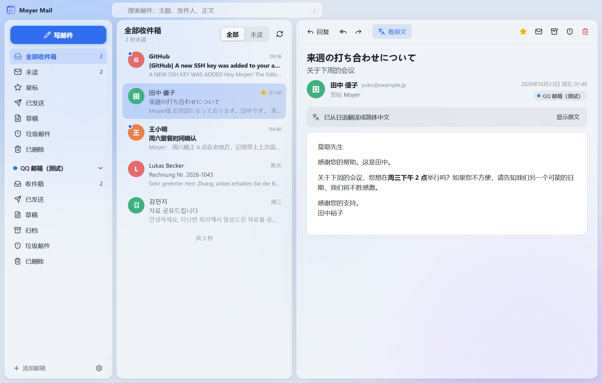

# Moyer Mail

个人用的多邮箱管理器：QQ、Gmail、Outlook、163 等邮箱放在一起收发，外语邮件一键翻译。
磨砂玻璃 + 纯色背景的界面，所有操作“先改界面、后台同步”，点开即出。

详细方案见 [docs/方案设计.md](docs/方案设计.md)。



## 安装

**电脑（Windows 10/11）**：到 [Releases 发布页](https://github.com/MoyerZhang-Claude/moyer-mails/releases/latest) 下载 `MoyerMail-Setup-x.x.x.exe`，双击安装。安装包没有数字签名，Windows 可能提示“未知发布者”，点“更多信息 → 仍要运行”即可。

关闭窗口时软件会缩到右下角托盘继续收信；要彻底退出，右键托盘图标 → 退出。

**安卓手机（Android 7.0 及以上）**：到 [全部发布](https://github.com/MoyerZhang-Claude/moyer-mails/releases) 里找“安卓版”，在手机上下载 `MoyerMail-Android-x.x.x.apk` 点开安装。第一次安装时系统会提示“允许安装未知应用”，按提示允许即可；一加 / OPPO 等手机可能要求“扫描”或提示“未经检测”，选继续安装。之后的新版本直接覆盖安装，账号不会丢。

- 想关掉 App 也能马上收到新邮件、定时邮件和稍后提醒按时处理：设置 → 通用 → 打开“退到后台后继续收信”，并点“允许在后台运行”。
- 在列表或读信界面右滑拉出侧栏，左滑收起；返回用手机自带的返回手势。
- Outlook 在手机上同样要先在 设置 → 账号登录 填写微软应用 ID（和电脑版用同一个）。

## 添加邮箱

| 邮箱 | 需要准备 |
|---|---|
| QQ 邮箱 | 网页版 设置 → 账号与安全 → 开启 IMAP/SMTP，生成**授权码**（不是 QQ 密码） |
| 163 / 126 | 网页版 设置 → POP3/SMTP/IMAP → 开启服务，获取**授权码** |
| Gmail | Google 账号开启两步验证 → 生成**应用专用密码**；大陆网络需要代理（设置 → 网络代理，默认跟随系统代理） |
| Outlook / Hotmail | 微软已关闭密码登录。先在 设置 → 账号登录 填写“微软应用 ID”（页面里有图文步骤，只需一次），再用“微软账号授权”登录 |
| 其他 | 选“其他邮箱”，填写 IMAP / SMTP 服务器 |

## 翻译

- 读信：外语邮件顶部会提示“这封邮件是 xx 语”，点“翻译”在原位翻译，保留排版；按 `T` 切换原文/译文。
- 划词：在邮件里选中一段文字，点弹出的“翻译”。
- 写信：用中文写好，底部选目标语言点“翻译成”，可以“回译检查”意思对不对，再替换正文或中外文对照发送。回复时会自动选成对方邮件的语言。
- 列表里的外语标题会直接显示中文译文（带“译”字，鼠标停留看原文）。
- 默认用 Google 免费翻译；也可以在 设置 → 翻译 换成微软 Azure（每月 200 万字符免费）、DeepSeek 等大模型或 DeepL。

## 其他常用功能

- **会话**：同一话题的往来邮件合并成一行，打开后按时间排列，旧的折叠。设置 → 外观 可关闭。
- **收信规则**：设置 → 收信规则，或邮件右键“自动处理此发件人的邮件…”，自动标已读、加星标、归档、不弹通知等。
- **稍后提醒**：工具栏闹钟按钮（`H`），邮件先隐藏，到点重新变成未读并提醒。
- **定时发送**：写信窗口“发送”旁的日历按钮；侧栏“定时发送”里可修改或取消。
- **全部标为已读**、**在服务器上搜索更早的邮件**。

## 快捷键

`J/K` 上下封 · `C` 写信 · `R` 回复 · `A` 全部回复 · `F` 转发 · `T` 翻译 · `S` 星标 · `U` 已读/未读 · `H` 稍后提醒 · `E` 归档 · `Delete` 删除 · `/` 搜索 · `Ctrl+Enter` 发送 · `Esc` 关闭弹窗

## 开发

```bash
npm install
npm run dev        # 开发模式（热更新）
npm test           # 引擎自动化测试（本机假 IMAP/SMTP 服务器）
npm run web        # 只在浏览器里看界面（演示数据）
npm run dist       # 打包 Windows 安装程序到 dist/
npm run android:apk  # 打包安卓开发版 APK（需要 JAVA_HOME 指向 JDK 21、ANDROID_HOME 指向 Android SDK）
```

安卓正式版：先 `npm run android:sync`，再在 `android/` 里运行 `gradlew assembleRelease`，生成 `android/app/build/outputs/apk/release/app-release.apk`（不可调试；签名说明见 `android/app/build.gradle`）。安卓版的界面和电脑版共用，收发信引擎是 `android/` 里用 Kotlin 重写的一份，开发记录见 [docs/进度.md](docs/进度.md)。

本地调试真实收发流程：`node tests/fake-servers.mjs` 会启动假的 IMAP（127.0.0.1:1143）和 SMTP（127.0.0.1:1025），用户名 `testuser`、密码 `testpass`，在软件里选“其他邮箱”、加密方式选 STARTTLS 即可连上（自签名证书，需要设置环境变量 `NODE_TLS_REJECT_UNAUTHORIZED=0` 启动）。

数据目录：`%APPDATA%\Moyer Mail\`（可用环境变量 `MOYER_DATA_DIR` 指定，便于便携使用）。

## 目录

```
src/shared/    界面与引擎共用：类型、MailApi 接口、服务商预设、语言、配色
src/core/      收发信引擎（纯 Node）：同步、发信、OAuth、翻译、数据库
src/main/      Electron 主进程：窗口、托盘、通知、IPC
src/preload/   安全桥
src/renderer/  React 界面（电脑版和安卓版共用）
android/       安卓工程（Capacitor）：app/src/main/java/com/moyer/mail/engine/ 是 Kotlin 收发信引擎
tests/         引擎端到端测试、假邮件服务器
scripts/       图标生成、安卓调试工具
```
